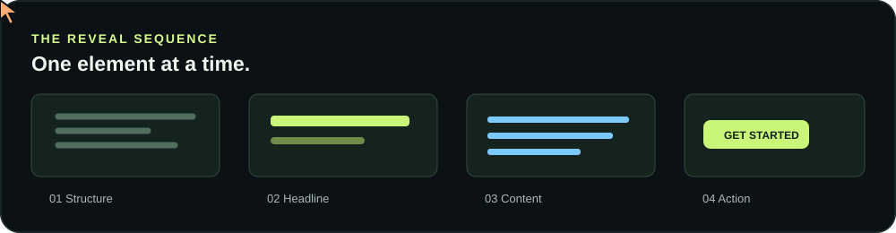
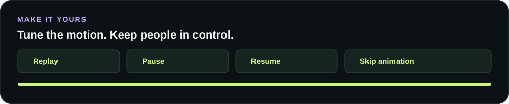
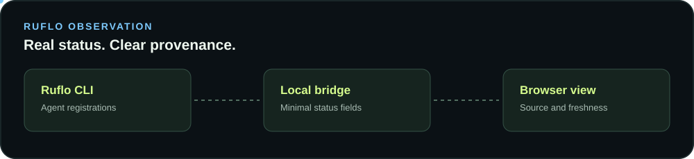

# Mouse Swarm Reveal

[](https://mouse-swarm-reveal.cognitum-consulting-mail.workers.dev/)

Turn a landing page into a visual build sequence. Elements appear in order while a swarm of colored cursors and agent markers moves around them.

[See the live reveal](https://mouse-swarm-reveal.cognitum-consulting-mail.workers.dev/) · [Try the interactive playground](https://mouse-swarm-reveal.cognitum-consulting-mail.workers.dev/demo/) · [Watch the 9:11 promo](https://ruv-built-by-the-swarm.ruv.chatgpt.site/ruflo-swarm-portrait.mp4) · [Ruflo](https://github.com/ruvnet/ruflo)

**Two ways to use it:** the page reveal is simulated visual choreography. The optional local Ruflo view reads reported agent registrations and statuses. Neither mode controls a computer or starts agents.

[Reveal quick start](#quick-start-build-a-reveal) · [Install the skill](#install-the-skill) · [Ruflo observation](#observe-a-local-ruflo-swarm) · [Configuration](#configuration) · [Troubleshooting](#troubleshooting)

[](https://mouse-swarm-reveal.cognitum-consulting-mail.workers.dev/demo/)

| Capability | What it does |
| --- | --- |
| Sequential reveal | Shows page elements in document order and optionally types leaf text. |
| Cursor choreography | Adds configurable visual cursors, colors, labels, and selection effects. |
| Playback | Exposes replay, pause, resume, skip, progress, and cleanup. |
| Ruflo observation | Shows local CLI agent registrations and reported status. |
| Agent skills | Installs reusable instructions and assets for Claude Code and Codex. |

## Install the skill

From your project directory, run:

```bash
npx skills add ruvnet/mouse-swarm --skill mouse-swarm-reveal -a claude-code -a codex -y --copy
```

This installs the skill and its bundled browser modules for both Claude Code and Codex. Use `-a claude-code` or `-a codex` to target one agent. Omit `-y` to review the installer prompts, or add `-g` to install globally. The current `skills` CLI requires Node.js 22.20 or later; check your installed CLI version for its requirements.

Then ask your agent:

> Use the mouse swarm reveal skill to make this landing page build itself in sequence. Include replay and skip controls.

**What is installed**

- A portable `SKILL.md` with the integration and validation workflow.
- A dependency-free browser module in `assets/mouse-swarm.js`.
- A standalone example in `assets/demo.html`.
- Ruflo adapter and view modules in `assets/ruflo.js` and `assets/ruflo-view.js`.

The installer is a separate tool. Review the skill before use, and use `--copy` when you want independent copies instead of symlinks.

## Quick start: build a reveal

**Requirements:** Node.js 18 or later for the package. The `skills` installer can have a newer Node requirement; check its output if installation fails.

1. Create a project directory and install the package from GitHub. The npm registry release is pending.

```bash
mkdir swarm-example
cd swarm-example
npm install github:ruvnet/mouse-swarm
cp node_modules/@ruvector/mouse-swarm/src/index.js ./mouse-swarm.js
```

2. Save the following as `index.html`. The order of the `data-swarm-item` elements is the order in which they appear. Keep controls outside the reveal targets so they remain available.

```html
<!doctype html>
<html lang="en">
<head><meta charset="utf-8"><meta name="viewport" content="width=device-width, initial-scale=1"><title>Swarm reveal</title></head>
<body>
  <main>
    <h1 data-swarm-item data-swarm-type>Build something together.</h1>
    <p data-swarm-item data-swarm-type>Give ideas room to grow.</p>
    <a data-swarm-item href="https://github.com/ruvnet/ruflo">Explore Ruflo</a>
  </main>
  <nav aria-label="Animation controls">
    <button id="replay">Replay</button>
    <button id="pause">Pause</button>
    <button id="resume">Resume</button>
    <button id="skip">Skip animation</button>
  </nav>
  <script type="module">
    import { createSwarmReveal } from './mouse-swarm.js';
    const reveal = createSwarmReveal({ cursors: 20, interval: 280 });
    document.querySelector('#replay').addEventListener('click', reveal.replay);
    document.querySelector('#pause').addEventListener('click', reveal.pause);
    document.querySelector('#resume').addEventListener('click', reveal.resume);
    document.querySelector('#skip').addEventListener('click', reveal.skip);
    reveal.start();
  </script>
</body>
</html>
```

3. Serve the folder over HTTP, then open `http://localhost:8000`:

```bash
python3 -m http.server 8000
```

The complete page remains readable without JavaScript. To use an existing bundler, import the package directly instead of copying the browser module:

```js
import { createSwarmReveal } from '@ruvector/mouse-swarm';
```

[](https://mouse-swarm-reveal.cognitum-consulting-mail.workers.dev/demo/)

## Use the browser module

For an existing project, install from GitHub:

```bash
npm install github:ruvnet/mouse-swarm
```

Mark elements in the order they appear in the document. Add `data-swarm-type` to a leaf element when its text should appear in chunks.

```html
<h1 data-swarm-item data-swarm-type>Build something together.</h1>
<p data-swarm-item data-swarm-type>Give ideas room to grow.</p>
<button id="skip">Skip animation</button>
```

```js
import { createSwarmReveal } from '@ruvector/mouse-swarm';

const reveal = createSwarmReveal({ cursors: 20, interval: 280 });
document.querySelector('#skip').addEventListener('click', reveal.skip);
reveal.start();

// Optional: reveal.replay() and reveal.destroy()
```

The overlay is pointer transparent and respects reduced motion, including changes during playback. Hidden targets are temporarily inert so keyboard users cannot focus invisible content. Overlapping targets cannot be owned by two instances from the same module; call `destroy()` when the component unmounts. Avoid marking both a parent and its descendants as reveal targets. Serve `examples/` over HTTP to try the interactive playground without a build tool.

## Observe a local Ruflo swarm

[Read the complete Ruflo user guide](docs/ruflo-user-guide.md) for setup, verification, custom integration, and troubleshooting.

[](https://github.com/ruvnet/ruflo)

The library includes an **opt in, read only** bridge for a locally installed Ruflo CLI. From the Ruflo project you want to observe:

```bash
npx --yes --package=github:ruvnet/mouse-swarm mouse-swarm observe --port 4173
```

Open `http://127.0.0.1:4173/` on that same machine. Stop the server with Ctrl+C. Install the Ruflo CLI first and check `ruflo agent list --format json` in the same project directory. The server polls `ruflo agent list --format json` in the current directory. It is bound to loopback, serves a bounded snapshot, and exposes only agent IDs, roles, and reported statuses. It never starts agents or runs tasks. Agent registrations and status values do not by themselves prove execution.

The Ruflo CLI does not provide cursor coordinates. The live status view shows a list when positions are unavailable; it never invents cursor movements. The separate landing page reveal remains a simulation. Task descriptions, prompts, and credentials are excluded from the local CLI bridge. Do not expose the local status server to the public internet.

For a custom authenticated backend, use the transport-neutral adapter and view. The following is an **illustrative event**, not a connection to Ruflo:

```js
import { createRufloSwarmAdapter } from '@ruvector/mouse-swarm/ruflo';
import { createRufloSwarmView } from '@ruvector/mouse-swarm/ruflo-view';

const adapter = createRufloSwarmAdapter({ maxAgents: 64 });
const view = createRufloSwarmView({ adapter, container: document.querySelector('#swarm') });
adapter.ingest({ type: 'agent.upsert', id: 'agent-1', role: 'reviewer', status: 'idle' });
// Only set connected after your own trusted source is verified.
// view.setSourceState('connected');
// On teardown: view.destroy(); adapter.dispose();
```

A trusted host can supply normalized agent updates and task status updates. Markers appear only for explicit normalized viewport coordinates supplied by the host; omit `position` if none are available. Protect and authorize the source on your server, minimize fields sent to the browser, and do not expose Ruflo credentials or private task text. The adapter does not connect to Ruflo or provide an authenticated transport by itself. When polling fails, retain the last snapshot only as stale and do not remove agents until a complete successful snapshot is available.

Use `adapter.replaceAgents(events)` for a complete snapshot. It validates the whole batch and replaces it atomically. For revisioned sources, equal revisions retain the previous agent data; newer revisions update it. The adapter remembers up to twice `maxAgents` recent revisioned removals, so the source must also enforce ordering or prevent delayed events after those removal records are evicted.

## Configuration

Pass options to `createSwarmReveal`. Defaults preserve the original reveal behavior.

| Option | Default | Purpose |
| --- | --- | --- |
| `root` | `document` | Limit the reveal to a document or element. |
| `selector` | `[data-swarm-item]` | Select targets in document order. |
| `cursors` | `20` | Number of visual cursors, from 0 to 80. |
| `interval` | `280` | Milliseconds between reveal steps; minimum 20. |
| `colors` | Seven preset colors | Array of 1 to 32 cursor color strings. |
| `cursorSize` | `15` | Cursor width in pixels, from 8 to 48. |
| `cursorSpeed` | `700` | Cursor movement time in milliseconds, from 0 to 10000. |
| `botEvery` | `5` | Every fifth marker is a bot; set to 0 for none. |
| `labels` | `[]` | Optional labels indexed by cursor, up to 80 strings. |
| `selection` | `true` | Show the selection outline around the current target. |
| `typeText` | `true` | Type text on marked leaf elements. |
| `typeWords` | `3` | Words per typing step, from 1 to 50. |
| `autoScroll` | `false` | Opt in to scrolling to each target. |
| `onStep` | None | Receive `{ kind, element, current, total }` after a reveal step. |
| `onComplete` | None | Receive `{ reason, current, total }` when a run completes or is skipped. |
| `onError` | None | Receive an animation or callback error after content is restored. |

```js
const reveal = createSwarmReveal({
  cursors: 32,
  colors: ['#c8f578', '#70c9f9', '#c9acff'],
  labels: ['Scout', 'Builder', 'Reviewer'],
  botEvery: 4,
  cursorSize: 20,
  cursorSpeed: 600,
  interval: 200,
  typeWords: 2,
  selection: true,
  autoScroll: false,
  onStep: ({ current, total }) => console.log(`${current}/${total}`),
  onComplete: ({ reason }) => console.log(reason),
  onError: (error) => console.error(error)
});
reveal.start();
reveal.pause();
reveal.resume();
// Also available: reveal.replay(), reveal.skip(), reveal.getState(), reveal.destroy().
```

`getState()` returns `{ status, current, total }`; status can include `error` if an animation step or callback fails. The original content is restored before `onError` runs. TypeScript declarations are included. Completion reasons are `completed`, `skipped`, `reduced-motion`, and `empty`. Reduced motion is always honored. `autoScroll` is optional because automatic scrolling can interrupt readers. Labels and cursor positions are illustrative, not agent telemetry.

## Troubleshooting

| Symptom | Check |
| --- | --- |
| Nothing animates | Check the console, that `start()` runs after the targets exist, and that the selector matches. Reduced motion intentionally skips the animation. |
| Module import fails | Serve the files over HTTP and verify the import path. Browsers cannot resolve npm package names without a bundler or import map. |
| Elements remain hidden or conflict | Avoid selecting nested targets or sharing targets between active instances. Call `destroy()` when the owning component is removed. |
| Ruflo view is empty | Run `ruflo agent list --format json` in the same project. An empty list means no registrations were reported, not that the connection failed. |
| Ruflo view reports an error | Confirm that the CLI is installed, on PATH, responds within five seconds, and emits valid JSON. The view keeps previous entries marked stale after a failed poll. |
| Port is in use | Pass a different port, for example `mouse-swarm observe --port 4180`. Open the printed URL on the same machine. |
| MP4 download is needed | Record or render the animation separately. The browser module does not create MP4 files. |

## Record, replay, and create

The local Ruflo observer can record observed agent snapshot changes in memory, replay them, and download a minimized JSON timeline. A host supplied MetaHarness adapter can map session envelopes into the same format. Observation times and snapshot changes do not prove execution or actual cursor movement.

The sample [visual studio](examples/studio.html) previews reveal settings and imports or exports configuration. The optional MP4 exporter creates portrait 9:11, square, and vertical videos from trusted local HTML. See the [activity and video guide](docs/activity-and-video.md) for setup, limitations, and MetaHarness examples. A [React example](examples/react/SwarmReveal.jsx) and [Cloudflare deployment guide](docs/cloudflare.md) are also available.

## Video and deployment

The [portrait MP4](https://ruv-built-by-the-swarm.ruv.chatgpt.site/ruflo-swarm-portrait.mp4) is a pre-rendered example, not a recording of live agents. The browser module does not generate video. The optional local MP4 exporter uses Playwright and FFmpeg; see the [activity and video guide](docs/activity-and-video.md).

The [live landing page](https://mouse-swarm-reveal.cognitum-consulting-mail.workers.dev/) runs on Cloudflare Workers. Its source is in `site/`. The `mouse.ruv.io` hostname is pending access to the Cloudflare account that controls its DNS zone.

## Development

```bash
npm test
npm pack --dry-run
```

MIT licensed.
