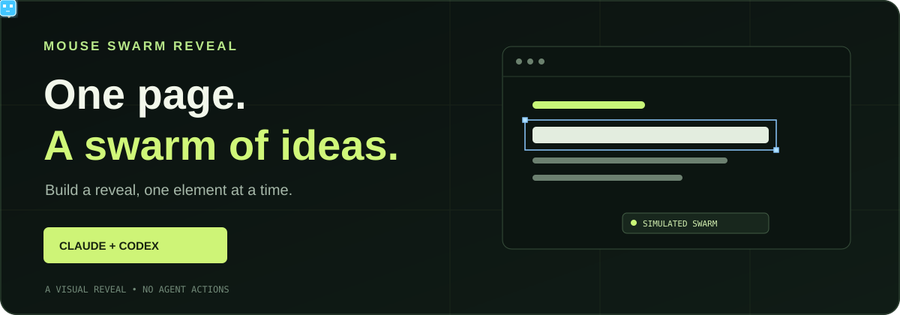

# Mouse Swarm Reveal

[](https://mouse-swarm-reveal.cognitum-consulting-mail.workers.dev/)

Turn a landing page into a visual build sequence. Elements appear in order while a swarm of colored cursors and agent markers moves around them.

[See the live reveal](https://mouse-swarm-reveal.cognitum-consulting-mail.workers.dev/) · [Try the interactive playground](https://mouse-swarm-reveal.cognitum-consulting-mail.workers.dev/demo/) · [Watch the 9:11 promo](https://ruv-built-by-the-swarm.ruv.chatgpt.site/ruflo-swarm-portrait.mp4) · [Ruflo](https://github.com/ruvnet/ruflo)

**The swarm is simulated.** It does not control a computer, run agents, or report live agent activity.

## Install the skill

From your project directory, run:

```bash
npx skills add ruvnet/mouse-swarm --skill mouse-swarm-reveal -a claude-code -a codex -y --copy
```

This installs the skill and its bundled browser module for both Claude Code and Codex. Use `-a claude-code` or `-a codex` to target one agent. Omit `-y` to review the installer prompts, or add `-g` to install globally. The current `skills` CLI requires Node.js 22.20 or later; check your installed CLI version for its requirements.

Then ask your agent:

> Use the mouse swarm reveal skill to make this landing page build itself in sequence. Include replay and skip controls.

**What is installed**

- A portable `SKILL.md` with the integration and validation workflow.
- A dependency-free browser module in `assets/mouse-swarm.js`.
- A standalone example in `assets/demo.html`.

The installer is a separate tool. Review the skill before use, and use `--copy` when you want independent copies instead of symlinks.

## Use the browser module

The npm registry release is pending. Install the package directly from GitHub:

```bash
npm install github:ruvnet/mouse-swarm
```

Mark elements in the order they appear in the document. Add `data-swarm-type` to a leaf element when its text should appear in chunks.

```html
<h1 data-swarm-item data-swarm-type>Build something together.</h1>
<p data-swarm-item data-swarm-type>Give ideas room to grow.</p>
<button id="skip">Skip animation</button>
```

```js
import { createSwarmReveal } from '@ruvector/mouse-swarm';

const reveal = createSwarmReveal({ cursors: 20, interval: 280 });
document.querySelector('#skip').addEventListener('click', reveal.skip);
reveal.start();

// Optional: reveal.replay() and reveal.destroy()
```

The overlay is pointer transparent and respects reduced motion, including changes during playback. Hidden targets are temporarily inert so keyboard users cannot focus invisible content. Overlapping targets cannot be owned by two instances from the same module; call `destroy()` when the component unmounts. Avoid marking both a parent and its descendants as reveal targets. Serve `examples/` over HTTP to try the interactive playground without a build tool.

## Observe a local Ruflo swarm

The library includes an **opt in, read only** bridge for a locally installed Ruflo CLI. From the Ruflo project you want to observe:

```bash
npx --yes --package=github:ruvnet/mouse-swarm mouse-swarm observe --port 4173
```

Open `http://127.0.0.1:4173/` on that same machine. The server polls `ruflo agent list --format json` in the current directory. It is bound to loopback, serves a bounded snapshot, and exposes only agent IDs, roles, and reported statuses. It never starts agents or runs tasks. Agent registrations and status values do not by themselves prove execution.

The Ruflo CLI does not provide cursor coordinates. The live status view shows a list when positions are unavailable; it never invents cursor movements. The separate landing page reveal remains a simulation. Task descriptions, prompts, and credentials are excluded from the local CLI bridge. Do not expose the local status server to the public internet.

For a custom authenticated backend, use the transport-neutral adapter and view. The following is an **illustrative event**, not a connection to Ruflo:

```js
import { createRufloSwarmAdapter } from '@ruvector/mouse-swarm/ruflo';
import { createRufloSwarmView } from '@ruvector/mouse-swarm/ruflo-view';

const adapter = createRufloSwarmAdapter({ maxAgents: 64 });
const view = createRufloSwarmView({ adapter, container: document.querySelector('#swarm') });
adapter.ingest({ type: 'agent.upsert', id: 'agent-1', role: 'reviewer', status: 'idle' });
// Only set connected after your own trusted source is verified.
// view.setSourceState('connected');
// On teardown: view.destroy(); adapter.dispose();
```

A trusted host can supply normalized agent updates and task status updates. Markers appear only for explicit normalized viewport coordinates supplied by the host; omit `position` if none are available. Protect and authorize the source on your server, minimize fields sent to the browser, and do not expose Ruflo credentials or private task text. The adapter does not connect to Ruflo or provide an authenticated transport by itself. When polling fails, retain the last snapshot only as stale and do not remove agents until a complete successful snapshot is available.

Use `adapter.replaceAgents(events)` for a complete snapshot. It validates the whole batch and replaces it atomically. For revisioned sources, equal revisions retain the previous agent data; newer revisions update it. The adapter remembers up to twice `maxAgents` recent revisioned removals, so the source must also enforce ordering or prevent delayed events after those removal records are evicted.

## Configuration

Pass options to `createSwarmReveal`. Defaults preserve the original reveal behavior.

| Option | Default | Purpose |
| --- | --- | --- |
| `root` | `document` | Limit the reveal to a document or element. |
| `selector` | `[data-swarm-item]` | Select targets in document order. |
| `cursors` | `20` | Number of visual cursors, from 0 to 80. |
| `interval` | `280` | Milliseconds between reveal steps; minimum 20. |
| `colors` | Seven preset colors | Array of 1 to 32 cursor color strings. |
| `cursorSize` | `15` | Cursor width in pixels, from 8 to 48. |
| `cursorSpeed` | `700` | Cursor movement time in milliseconds, from 0 to 10000. |
| `botEvery` | `5` | Every fifth marker is a bot; set to 0 for none. |
| `labels` | `[]` | Optional labels indexed by cursor, up to 80 strings. |
| `selection` | `true` | Show the selection outline around the current target. |
| `typeText` | `true` | Type text on marked leaf elements. |
| `typeWords` | `3` | Words per typing step, from 1 to 50. |
| `autoScroll` | `false` | Opt in to scrolling to each target. |
| `onStep` | None | Receive `{ kind, element, current, total }` after a reveal step. |
| `onComplete` | None | Receive `{ reason, current, total }` when a run completes or is skipped. |
| `onError` | None | Receive an animation or callback error after content is restored. |

```js
const reveal = createSwarmReveal({
  cursors: 32,
  colors: ['#c8f578', '#70c9f9', '#c9acff'],
  labels: ['Scout', 'Builder', 'Reviewer'],
  botEvery: 4,
  cursorSize: 20,
  cursorSpeed: 600,
  interval: 200,
  typeWords: 2,
  selection: true,
  autoScroll: false,
  onStep: ({ current, total }) => console.log(`${current}/${total}`),
  onComplete: ({ reason }) => console.log(reason),
  onError: (error) => console.error(error)
});
reveal.start();
reveal.pause();
reveal.resume();
// Also available: reveal.replay(), reveal.skip(), reveal.getState(), reveal.destroy().
```

`getState()` returns `{ status, current, total }`; status can include `error` if an animation step or callback fails. The original content is restored before `onError` runs. TypeScript declarations are included. Completion reasons are `completed`, `skipped`, `reduced-motion`, and `empty`. Reduced motion is always honored. `autoScroll` is optional because automatic scrolling can interrupt readers. Labels and cursor positions are illustrative, not agent telemetry.

## Video and deployment

The [portrait MP4](https://ruv-built-by-the-swarm.ruv.chatgpt.site/ruflo-swarm-portrait.mp4) is a pre-rendered example, not a recording of live agents. The browser module does not generate video; use a separate recording or rendering workflow when an MP4 is required.

The [live landing page](https://mouse-swarm-reveal.cognitum-consulting-mail.workers.dev/) runs on Cloudflare Workers. Its source is in `site/`. The `mouse.ruv.io` hostname is pending access to the Cloudflare account that controls its DNS zone.

## Development

```bash
npm test
npm pack --dry-run
```

MIT licensed.
