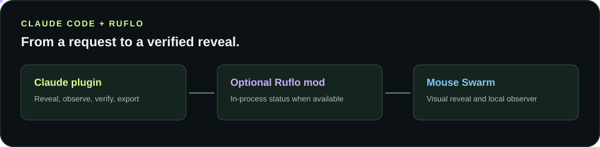

# Claude Code plugin and Ruflo mod

[](../README.md#claude-code-plugin-and-ruflo-mod)

The Mouse Swarm Claude Code plugin packages the existing reveal skill, four commands, and an optional function hook mod. The existing [Codex and Claude skill installation](../README.md#install-the-skill) still works independently.

## Install

From an interactive Claude Code session:

```text
/plugin marketplace add ruvnet/mouse-swarm
/plugin install mouse-swarm@mouse-swarm
```

If Claude Code asks to reload plugins, use `/reload-plugins` or follow its prompt. You can inspect the plugin locally before installation:

```bash
git clone https://github.com/ruvnet/mouse-swarm.git
claude plugin validate ./mouse-swarm
claude --plugin-dir ./mouse-swarm
```

For a terminal based installation, consult your installed Claude Code version's plugin help. The plugin commands and bundled skill do not require Ruflo to be installed.

## Commands

| Command | Use |
| --- | --- |
| `/mouse-swarm:reveal` | Apply the reveal skill to a page or project. |
| `/mouse-swarm:observe` | Guide setup of the read only local Ruflo status view. |
| `/mouse-swarm:verify` | Verify reveal behavior using Playwright when available. |
| `/mouse-swarm:video` | Export a trusted local page or recorded observation to MP4. |

Add your request after the command. For example:

```text
/mouse-swarm:reveal Build the current landing page in sequence with replay and skip controls.
/mouse-swarm:verify Check the current reveal in Chromium and test reduced motion.
```

The plugin provides instructions; it does not execute commands, record activity, or publish outputs merely by being installed.

## Optional Ruflo mod integration

Install Ruflo's separate mod through its marketplace if you want the status integration:

```text
/plugin marketplace add ruvnet/ruflo
/plugin install ruflo-mods@ruflo
```

The Mouse Swarm mod observes successful `agent.spawn` hook callbacks in process and counts them without retaining agent IDs, prompts, tool arguments, or task results. When `ruflo-mods` provides its documented `$.ruflo` interface, the mod contributes an optional Mouse Swarm status segment. Run `/mouse-swarm-mod-status` to see the process-local spawn count and, when available, Ruflo's policy mode and route count. If the Ruflo interface is unavailable, the plugin continues without that status integration. An installed Ruflo plugin may still report unavailable if its in-process interface did not load in the current session. It does not automatically install or enable Ruflo mods or change your project configuration.

### If Ruflo reports unavailable

An isolated comparison on Claude Code 2.1.283 found that `ruflo-mods` 0.7.0 did not expose the interface, while upstream 0.16.2 did. This is a verified working version, not a declared minimum. Refresh and update your Ruflo plugin if appropriate for your installation:

```bash
claude plugin marketplace update ruflo
claude plugin update ruflo-mods@ruflo --scope user
```

Restart the Claude Code session to apply the update, then run `/mouse-swarm-mod-status` again. The exact update and installed version depend on your marketplace and scope.

Ruflo's mod documentation states that function hooks are enabled by default in Claude Code 2.1.287 and later. Versions 2.1.277 through 2.1.286 require `CLAUDE_CODE_ENABLE_FUNCTION_HOOKS=1`. Organization policy, safe mode, or other Claude settings can also prevent mods from loading. See the [Ruflo mod guide](https://github.com/ruvnet/ruflo/tree/main/plugins/ruflo-mods) and [Claude mod documentation](https://code.claude.com/docs/en/plugins/mods/create) for current requirements. The command and skill files remain available when the hook module is not active.

The spawn count is a count of observed hook callbacks, not proof that a task ran. Ruflo's policy and route counters are mod status, not live cursor coordinates. The local browser observer continues to use CLI snapshots; it does not subscribe to the mod's hooks. For observed status and replay, see the [Ruflo guide](ruflo-user-guide.md).

## Verify

Run `claude plugin validate ./mouse-swarm` against a local checkout. In Claude Code, confirm the plugin and its commands are loaded. If the mod is supported and enabled, run `/mouse-swarm-mod-status`; if Ruflo is not loaded, it should report that without failing the session. Test an actual agent spawn only in a project where you have authorized it, and distinguish registration from execution.
