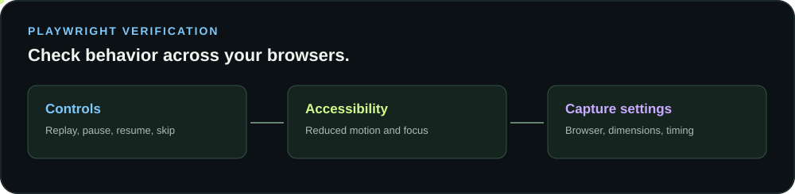

# Playwright integration and settings

[](../README.md#playwright-verification)

Use the optional Playwright integration to check a reveal on an existing browser page, or use Playwright and FFmpeg to record a trusted local page or saved activity timeline. Playwright controls a test browser; the simulated cursors remain visual effects and are not evidence of real agents or computer input.

## Install and run the offline browser check

From a checkout of this repository, install Playwright and a matching browser:

```bash
npm install --no-save playwright
npx playwright install chromium
node examples/playwright-check.mjs
```

The example serves only the bundled demo on loopback and checks pause, resume, skip, restored targets, overlay pointer transparency, and reduced motion. To try Firefox, install it with `npx playwright install firefox`, then run `SWARM_BROWSER=firefox node examples/playwright-check.mjs`. `SWARM_BROWSER=webkit` selects WebKit when its browser and system dependencies are installed. `SWARM_BROWSER_PATH` optionally selects a browser executable; Playwright recommends its matching browser builds for compatibility.

A passing check prints a `PASS` line naming the browser. This integration was exercised with Chromium and Firefox in the project test environment. WebKit requires its own operating system libraries and was not verified there. See [Playwright browser installation](https://playwright.dev/docs/browsers) for platform dependencies.

## Use the harness with an existing page

The helper accepts a Playwright `Page` that you created and navigated yourself. It does not start a browser, navigate to a URL, start agents, or fetch telemetry.

```js
import {createPlaywrightRevealHarness} from '@ruvector/mouse-swarm/playwright';

const reveal = createPlaywrightRevealHarness({
  page,
  root: '#reveal',
  targets: '[data-swarm-item]',
  overlay: '.ms-overlay',
  controls: {replay: '#apply', pause: '#pause', resume: '#resume', skip: '#skip'}
});

await reveal.press('skip');
const state = await reveal.waitForTargetsVisible({timeout: 5000, minTargets: 1});
if (state.hidden !== 0 || state.overlayPointerTransparent !== true) {
  throw new Error('Reveal did not restore targets or allow pointer input');
}
await reveal.setReducedMotion(true);
await reveal.press('replay');
```

`inspect()` reports selected target counts, remaining hidden markers, whether hidden targets are inert, overlay count and pointer transparency, and reduced motion. An absent overlay returns `null` for pointer transparency rather than reporting success. `waitForTargetsVisible()` checks that the module's hidden markers are gone; it does not prove typing or completion callbacks have finished. Check your application’s own completion indicator when that distinction matters. `press()` only operates the control selectors supplied by your application.

The same helper works with plain HTML and component frameworks when selectors target the actual rendered page. An example React component is in [examples/react](../examples/react/SwarmReveal.jsx).

## Configure video export

Install Playwright 1.48 or later, a matching browser, and FFmpeg with libx264. The exporter uses Playwright WebSocket routing to block external sockets. The two commands accept the same video settings:

```bash
npx mouse-swarm-video --input examples/demo.html --output reveal.mp4 --config examples/video-settings.json
npx mouse-swarm-activity-video --input observations.json --output activity.mp4 --config examples/video-settings.json
```

Run from a checkout containing the example paths, or supply your own paths. The commands require a local HTML page or recording, respectively. They do not fetch a website by URL. Command line options override JSON settings. Input and output paths must be supplied on the command line. Unknown configuration fields are rejected.

| JSON key | Default | Supported settings |
| --- | --- | --- |
| `preset` | `portrait` | `portrait` is 1080 × 1320, `square` is 1080 × 1080, `vertical` is 1080 × 1920. |
| `width`, `height` | Preset dimensions | Even integers from 2 to 1920; override the corresponding preset dimension. |
| `duration` | `10` | Seconds, from 0.1 to 60. |
| `fps` | `24` | Integer frames per second, from 1 to 60. |
| `browser` | `chromium` | `chromium`, `firefox`, or `webkit`, if installed. |
| `browserExecutable` | Playwright default | Optional local executable path. |
| `jpegQuality` | `85` | Screenshot quality from 1 to 100. |
| `crf` | `23` | H.264 constant rate factor from 0 to 51; lower generally means larger files. |
| `encoderPreset` | `medium` | libx264 preset from `ultrafast` through `veryslow`. |
| `colorScheme` | `light` | `light`, `dark`, or `no-preference`. |
| `reducedMotion` | `no-preference` | `reduce` or `no-preference`. |
| `waitMs` | `0` | Delay after page load before capture, from 0 to 10000 ms. |

For example, override the saved settings for a smaller Firefox capture:

```bash
npx mouse-swarm-video --input examples/demo.html --output preview.mp4 \
  --config examples/video-settings.json --browser firefox \
  --width 720 --height 880 --duration 5 --fps 12
```

Flags use hyphenated names, such as `--jpeg-quality`, `--encoder-preset`, and `--reduced-motion`. `--chromium` remains an alias for a custom Chromium executable path. Use `--browser-executable` for the selected engine. Reduced motion may complete the reveal immediately; use it for accessibility verification, not when a full animation is desired. Startup delay can skip early animation frames.

Exported videos are H.264 without audio. Outputs are never overwritten; failed exports may leave partial files. The activity exporter rescales observed timing to fit the requested clip and can expose IDs and source labels. Review outputs before sharing.

The exporter blocks external requests, WebSockets, downloads, and service workers, but this is not a sandbox. Only render local HTML you trust. See [activity and video](activity-and-video.md) for provenance and recording limitations.
